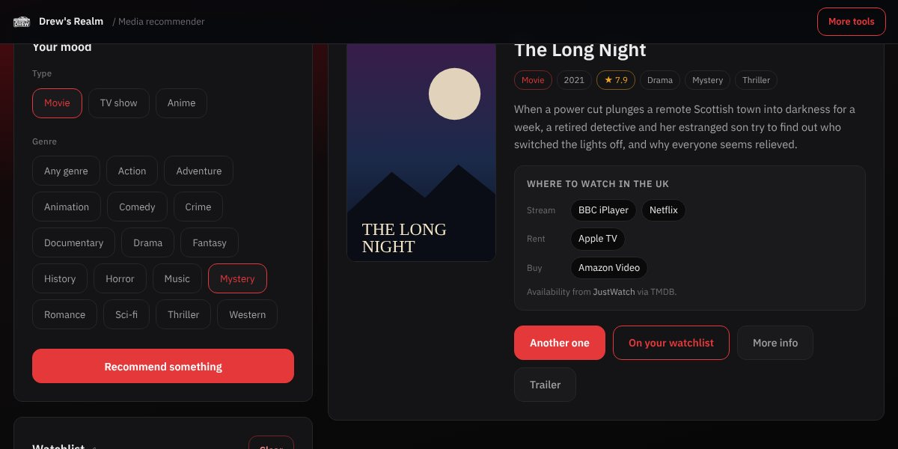

# Media recommender



Pick a mood and get a film, TV show or anime to watch. Live at <https://mediarec.drew-gnr.xyz/>.

## Features

- Movies and TV shows from TMDB, anime from Jikan (MyAnimeList)
- A genre list for each type, plus "any genre"
- Poster, year, rating, genres and description, all inserted as text so nothing from the APIs can run as HTML
- "Another one" skips titles you've already been shown this session
- Watchlist saved in the browser, with remove and clear (clear asks first)
- Where to watch: streaming, free, rent and buy services in the UK for films and TV, and streaming services for anime
- More info and trailer links for every pick, going straight to the official trailer when there is one
- Errors show a plain message and a retry button
- The type you picked last (film, TV or anime) is remembered

## TMDB helper (`worker/`)

The TMDB key is never in the page. Films and TV go through a small Cloudflare Worker at `https://api.drew-gnr.xyz/tmdb` (set by `CONFIG.workerUrl` at the top of `assets/app.js`), which adds the key, picks a well-rated title, and looks up its trailer and where to watch it.

Deploying it, from the `worker` folder:

```bash
npx wrangler secret put TMDB_TOKEN
```

```bash
npx wrangler deploy
```

`TMDB_TOKEN` is the "API Read Access Token" from your TMDB account settings. `TMDB_API_KEY` (the shorter v3 key) also works if you'd rather use that, and so does `TMDB_KEY`, the name the first version of the worker stored it under. The Worker is called `api` on Cloudflare, so a deploy replaces the live one and keeps its stored key. `wrangler.toml` sets the route, `ALLOWED_ORIGINS` (comma-separated sites allowed to call it) and `REGION` (the default country for where-to-watch, `GB`).

A browser request from any site not in `ALLOWED_ORIGINS` gets a 403 before TMDB is called. Requests that send no `Origin` header at all (curl, scripts) still get through, because there is no way to tell them apart from a direct visit, so add a Cloudflare rate-limiting rule for `api.drew-gnr.xyz/tmdb*` to protect the TMDB key's quota.

The page calls `GET /tmdb?type=movie|tv&genre=<name>&exclude=<title,title>&exclude_id=<id,id>`, with an optional `region=US` style code, and gets back:

```json
{
  "id": 1, "title": "", "year": 2021, "score": "7.9", "genres": ["Drama"], "desc": "",
  "poster": "https://image.tmdb.org/...", "link": "https://www.themoviedb.org/movie/1",
  "trailer": "https://www.youtube.com/watch?v=...",
  "providers": { "region": "GB", "link": "...", "stream": [{ "name": "Netflix", "logo": "..." }], "free": [], "rent": [], "buy": [] }
}
```

Errors come back as `{ "error": "message" }`. The page still works with an older helper that leaves out `trailer` and `providers`; it just skips those parts.

Where-to-watch data comes from JustWatch through TMDB, and the page credits them as their terms ask.

Anime needs no key. Jikan is rate limited, so the page spaces its calls out.

## Files

| Path | What it is |
| --- | --- |
| `index.html` | The page |
| `assets/app.js` | Fetching, rendering and the watchlist |
| `assets/app.css` | Layout for this tool |
| `worker/worker.js`, `worker/wrangler.toml` | The TMDB helper |
| `tests/worker.test.mjs` | `node tests/worker.test.mjs` |
| `assets/theme.css`, `assets/ui.js` | Shared drew-gnr.xyz look and helpers |
| `assets/fonts/` | IBM Plex, self-hosted (SIL OFL, see `OFL.txt`) |

## Hosting

The page is static files only. The `worker` folder is deployed separately to Cloudflare and does not need to be on the site.
